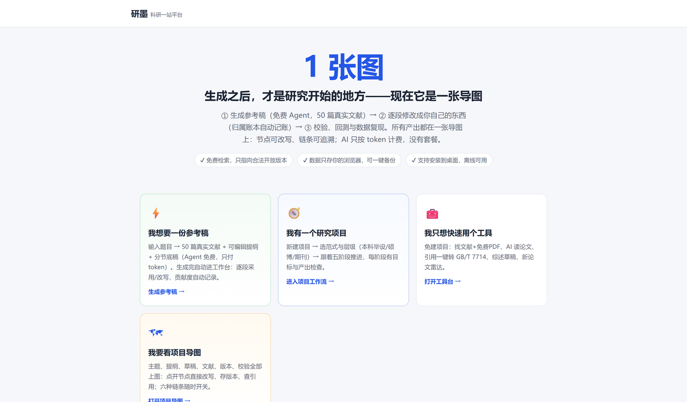
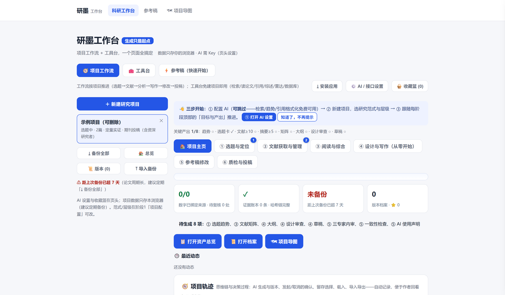

# 研墨 · 科研工作台

一个纯前端的科研工作台：文献、提纲、草稿、版本、引用放在一张项目导图上，AI 参与过的每一步都有记录。

- 网页版：https://www.yanmo.io/
- 专业版（可安装到桌面）：https://peacefulj.github.io/wenqu/
- 不需要后端，不需要数据库，数据默认只存在你的浏览器里。





## 它适合做什么

- 从题目开始，检索文献、生成可编辑提纲和参考稿；
- 按本科毕设 / 硕博 / 期刊分层，按阶段推进一个研究项目；
- 在项目导图里管理主题、提纲、草稿、文献、版本和校验；
- 用“归属账本”记录哪些段落由 AI 生成、哪些经过你改写；
- 引用格式一键转 GB/T 7714，并做正文与文献表的反向核对。

## 它不做什么

- 不提供代写、代查、代下文献；
- 不承诺“降 AIGC 率”或规避检测；
- 不保证 AI 输出正确，所有结论都需要回原文核对。

## 快速开始

### 直接使用

打开 https://www.yanmo.io/ ，在页头的「AI / 接口设置」里填写：

- Base URL：兼容 OpenAI 的接口地址，例如 `https://yingcompute.com/v1`
- API Key：你自己的 Key
- Model：模型名

Key 只保存在当前浏览器的 localStorage 里，不会上传到我们的服务器。

### 自己部署

不需要构建工具，也不需要服务器：

1. Fork 本仓库；
2. 在 Settings → Pages 中选择从 `main` 分支根目录发布；
3. 打开分配到的域名；
4. 在设置里填入自己的接口地址、Key 和模型。

也可以直接把仓库放到任意静态托管（Nginx、对象存储、内网服务器）上。

## 技术结构

```text
index.html / quick.html / studio.html / map.html / workbench.html
assets/
  wq-core.js     存储、AI 调用、流水线、diff、账本
  wq-quick.js    文献检索、提纲、分节写作
  studio.js      项目与章节管理、导出
  wq-map.js      项目导图
  wq-ui.js       通用交互组件
  paradigms.js   学科范式与层级配置
  vendor/        cytoscape、marked、pdf.js、DOMPurify、citation.js
sw.js            Service Worker（PWA 离线缓存）
manifest.webmanifest
```

- **存储**：localStorage 保存项目快照、AI 设置和用量；IndexedDB 归档较长的历史版本。
- **AI**：标准 Chat Completions 接口，流式输出，优先使用接口返回的 usage 计量。
- **文献**：OpenAlex 公开接口，按 DOI / 标题去重，摘要由倒排索引还原。
- **可追溯**：段落级 diff 计算人工贡献度，修改写入账本，关键操作使用 SHA-256 哈希链。
- **离线**：Service Worker 预缓存应用外壳；文献和 AI 请求需要联网。

## 数据与隐私

- 项目数据默认只存在当前浏览器，**没有云同步**；
- 换电脑、清缓存前，请先在应用内导出备份；
- API Key 存在 localStorage，公共电脑上用完请清除；
- 建议使用单独的 Key 并设置额度。

## 已知限制

- 中文文献覆盖有限，知网全文需要自行下载后导入；
- 参考稿 Agent 仍在迭代，日常更推荐“项目工作流 + 工具台”；
- 依赖较新的 JavaScript 语法，旧浏览器可能无法运行；
- 多标签页同时编辑仍有覆盖风险，建议一次只开一个标签页。

## 开发

没有打包步骤，修改 `assets/` 下的文件后刷新页面即可。更新 `sw.js` 时请把缓存版本号加 1，旧缓存会自动清理。

欢迎提 issue 和 PR：修 bug、接新的模型服务商、补文献源、改界面都可以。

## License

[MIT](LICENSE)
